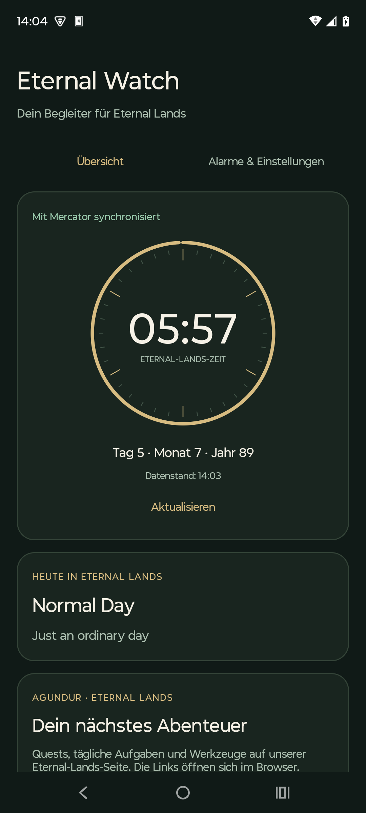

<p align="center">
  
</p>

<p align="center">
  
  
  
</p>

<p align="center">
  <a href="https://github.com/Agundur-KDE/Eternal-Watch/releases"><strong>📥 Download the alpha</strong></a>
  &nbsp; · &nbsp;
  <a href="https://eternal-lands.agundur.de/">🌍 Quest &amp; daily guides</a>
</p>

## ⚔️ A little help on your adventures

| | In your pocket |
|---|---|
| 🕰️ **EL time** | Game clock and calendar at a glance. |
| ✨ **Special Days** | See the current day and pick your favourites from 49 days for alerts. |
| 🐉 **Invasion reports** | Read the latest warning and its age, with optional alerts and sound. |
| 📱 **Home-screen widget** | A timestamped clock/day sample and a refresh button. |
| 🧭 **Guides** | Jump to quests, dailies, Haidir, Daritha and Xaquelina in your browser. |

**No ads. No account. No tracking SDK.** Interface in 🇩🇪 German, 🇬🇧 English,
🇪🇸 Spanish and 🇷🇺 Russian; game names and live reports stay in English.

<p align="center">
  
</p>

## 🎮 Get started

Download the **APK** from [Releases](https://github.com/Agundur-KDE/Eternal-Watch/releases)
and install it on **Android 8+**. Choose your Special Days in **Alerts & settings**;
turn on background monitoring if you want alerts while the app is closed.

📶 **Unmetered connections by default.** Mobile data and metered hotspots require
an explicit opt-in. Android Data Saver pauses metered updates.

🌱 **Early alpha.** Battery saving can delay alerts. The widget shows a saved
sample, and an invasion report does not confirm that an invasion is still active.
See each release for the current test status and known limits.

<details>
<summary>🛠️ Build it yourself</summary>

Requires JDK 17+, Android SDK 36 and Python 3.9+.

```sh
bash tools/build_apk.sh
```

Produces `dist/Eternal-Watch-debug.apk`.
[Development & testing](docs/development.md) · [Release builds](docs/release.md)

</details>

---

An unofficial **Eternal Lands** companion by Agundur. Game data from
[Mercator](https://mercator.holy-eternalland.de/api), clock/alarm rules adapted from
[EL-Klock](https://github.com/Agundur-KDE/EL-Klock).
[GPL-3.0-only](LICENSE) · [Credits & provenance](NOTICE.md)
